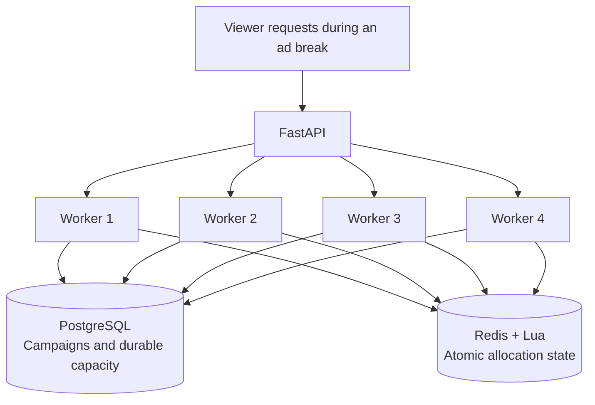
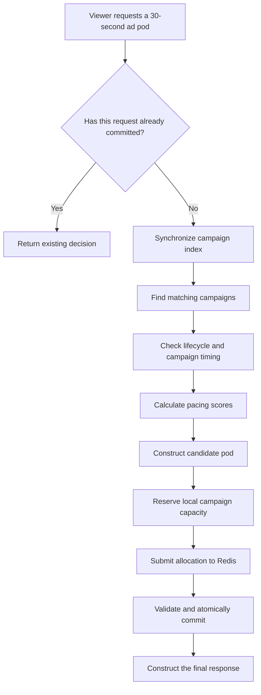
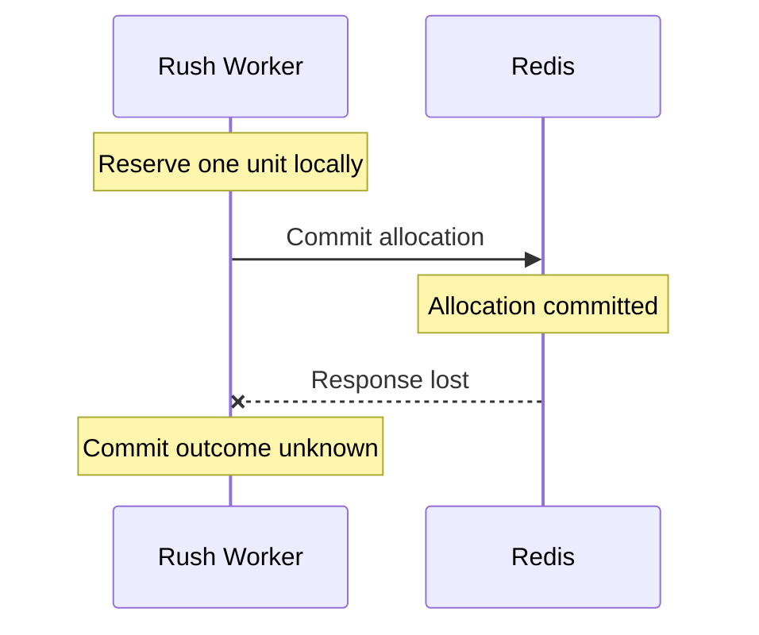

# Project Rush

### Building the decision brain behind a live ad break

Imagine an India vs Australia World Cup final.

India needs 18 runs from the last two overs. Millions of people are watching. The over ends, and the broadcast cuts to a 30-second ad break.

Somewhere behind the scenes, an advertising system suddenly has to decide what advertisements to show each viewer.

Consider three people watching the same match.

- Someone in Mumbai is watching on their television.
- Someone in Bengaluru is watching on their phone.
- Someone in Delhi has already seen a particular advertisement three times in the past hour.

Meanwhile, advertisers have their own requirements.

Nike might want to target mobile viewers in Mumbai.

Samsung might have only 500 allocations remaining.

An advertiser might not want its advertisement appearing alongside a direct competitor.

Some advertisements are 15 seconds long, others are 10 seconds or 5 seconds. The platform has only 30 seconds to fill.

Now imagine thousands of viewers requiring these decisions almost simultaneously.

The advertising system needs to answer a seemingly simple question:

> Which advertisements should this particular viewer receive in this particular ad break?

But answering that question requires solving several other problems.

How do we find eligible advertisements without searching every campaign?

How do we prevent concurrent requests from exceeding an advertiser's allocated capacity?

How do we prevent a viewer from repeatedly seeing the same advertisement?

How do we construct the best possible combination of advertisements within a fixed duration?

What happens if the database is slow, a worker crashes, or Redis commits an allocation but the response never reaches the application?

These are the problems I explored through **Project Rush**.

Rush is a Python-based ad allocation backend that focuses on the engineering behind campaign selection, concurrent resource allocation, consistency, optimization and failure handling.

The main principle behind the project is:

> **Optimization can speculate. Commitment cannot.**

---

## Project status

**Rush V1 — Feature complete, tested and benchmarked.**

| Metric | Result |
|---|---:|
| Regression tests | 75/75 passing |
| Independent benchmark trials | 7 |
| Successful benchmark requests | 8,400 |
| Simulated viewers per primary burst | 1,000 |
| API worker processes | 4 |
| Commercial campaigns | 100 |
| Audited correctness violations | 0 |
| Observed campaign capacity overspend | 0 |
| Successful identical request replays | 350/350 |
| Additional allocations caused by replays | 0 |

Rush successfully completed the tested concurrent workload without any observed correctness violations.

The benchmarks also exposed significant performance and capacity utilization limitations, which are documented in detail below.

Rush is an exploration of the engineering behind an ad allocation system, not a claim of production readiness or the ability to serve millions of viewers.

---

## Table of contents

- [Why I built this](#why-i-built-this)
- [Understanding the problem](#understanding-the-problem)
- [System architecture](#system-architecture)
- [How a request travels through Rush](#how-a-request-travels-through-rush)
- [Campaign lifecycle and targeting](#campaign-lifecycle-and-targeting)
- [Candidate discovery](#candidate-discovery)
- [Keeping the index synchronized](#keeping-the-index-synchronized)
- [Campaign capacity and concurrency](#campaign-capacity-and-concurrency)
- [Hierarchical capacity leasing](#hierarchical-capacity-leasing)
- [Frequency caps](#frequency-caps)
- [Request idempotency](#request-idempotency)
- [Campaign pacing](#campaign-pacing)
- [Building the ad pod](#building-the-ad-pod)
- [Competitive exclusion](#competitive-exclusion)
- [Proposal vs commitment](#proposal-vs-commitment)
- [Failure handling and recovery](#failure-handling-and-recovery)
- [API documentation](#api-documentation)
- [Benchmarking](#benchmarking)
- [Benchmark results](#benchmark-results)
- [Capacity utilization](#capacity-utilization)
- [What went wrong during benchmarking](#what-went-wrong-during-benchmarking)
- [Performance profiling](#performance-profiling)
- [Testing](#testing)
- [Benchmark artifacts](#benchmark-artifacts)
- [Technology stack](#technology-stack)
- [Getting started](#getting-started)
- [Reproducing the benchmarks](#reproducing-the-benchmarks)
- [Known limitations](#known-limitations)
- [Future development](#future-development)
- [Inspiration and references](#inspiration-and-references)
- [The part I actually care about](#the-part-i-actually-care-about)

---

## Why I built this

The idea came from looking at different parts of how large streaming and advertising systems work.

Google Ad Manager got me interested in things like campaign targeting, frequency caps, video ad pods and PPID.

JioHotstar made me think about the concurrency aspect of the problem. Unlike normal website traffic, a live sports event can cause a large number of viewers to require advertisements at almost exactly the same time.

Netflix got me thinking about advertising from the viewer's perspective.

You probably do not want someone watching a two-hour movie to see the same advertisement twenty times, even if that advertiser has plenty of remaining budget.

I also came across Google's paper:

**SHALE: An Efficient Algorithm for Allocation of Guaranteed Display Advertising.**

That introduced another interesting question.

If an advertiser wants 100,000 allocations over ten days, should the system allow all 100,000 to be consumed on the first day?

Probably not.

Rush does not implement SHALE, but the paper influenced how I thought about campaign pacing and the difference between eligibility and delivery objectives.

Each of these systems exposed a different part of the same problem.

Rather than trying to recreate their private architectures, I wanted to build a smaller system where I could explore the underlying engineering challenges myself.

---

## Understanding the problem

Before discussing databases or algorithms, it helps to understand what Rush is actually allocating.

### What is a campaign?

Suppose Nike wants to advertise during a cricket tournament.

It provides the following requirements:

| Property | Value |
|---|---|
| Campaign | Nike Cricket Campaign |
| Total allocation capacity | 10,000 |
| Target region | Mumbai |
| Target device | Mobile |
| Subscription tier | Free |
| Advertisement duration | 15 seconds |
| Viewer frequency cap | 3 per hour |
| Competitive group | Sportswear |
| Campaign duration | 7 days |

Rush stores these requirements as a campaign.

The campaign's capacity represents the total number of commercial allocation units available to it.

For V1, one successful commercial slot allocation consumes one unit of campaign capacity, regardless of the advertisement's duration.

A 15-second advertisement and a 5-second advertisement each consume one allocation unit from their respective campaigns.

Rush does not currently model actual financial spending, auction prices or confirmed advertisement impressions.

When I refer to capacity, consumption or overspending throughout this documentation, I am referring to allocation units.

### What is an ad pod?

An ad pod is a collection of advertisements that fit within a single ad break.

For example:

```text
30-second ad break

Nike       15 seconds
Samsung    10 seconds
Spotify     5 seconds

Total      30 seconds
```

Rush attempts to construct a pod that fills as much of the available duration as possible while respecting the applicable constraints.

### What makes an advertisement eligible?

A campaign must satisfy several requirements before it can become a commercial allocation.

| Constraint | Example |
|---|---|
| Campaign lifecycle | The campaign must be active |
| Campaign timing | The campaign must have started and not expired |
| Geographic targeting | Mumbai viewers only |
| Device targeting | Mobile devices only |
| Subscription targeting | Free subscribers only |
| Frequency cap | Maximum three allocations per viewer per hour |
| Available capacity | The campaign must have allocation authority available |
| Advertisement duration | The advertisement must fit inside the break |
| Competitive exclusion | Nike and Adidas cannot appear together |
| Index consistency | The proposal must use an acceptable campaign index version |

Some of these conditions can be checked while constructing a proposal.

Others need to be checked again at commitment because concurrent requests can change the relevant state.

This distinction becomes important later.

---

## System architecture

Rush uses three different kinds of state.

```text
PostgreSQL

    Durable campaign configuration
    Campaign lifecycle
    Remaining unleased capacity
    Issued capacity leases


Redis

    Viewer frequency counters
    Committed decision records
    Pacing counters
    Campaign index version
    Atomic allocation commitment


Worker memory

    Inverted campaign index
    Locally available capacity
    Lease refill coordination
    Pod optimization
```

I wanted each component to handle the type of work it was actually suited for rather than forcing everything into one database.



The four-worker configuration shown here is the configuration used during benchmarking. Rush does not require exactly four worker processes.

### Why PostgreSQL?

Campaign capacity is finite, and multiple workers might attempt to request additional capacity simultaneously.

PostgreSQL provides transactions, row-level locking, constraints and durable storage.

These properties make it suitable for maintaining campaign configuration and controlling how much allocation authority is issued.

### Why Redis?

Some state is accessed or modified repeatedly during request processing.

For example:

- Has this viewer already received Nike three times?
- Has this request already been committed?
- How many allocations has this campaign consumed?
- Is the worker using a stale campaign index?

Redis provides fast access to this state and supports Lua scripts, which allow multiple related operations to execute atomically.

That makes it suitable for the request-time commitment boundary.

### Why worker memory?

Not every operation requires a database.

Candidate discovery and pod optimization are primarily computation problems.

Workers also hold previously issued campaign capacity locally, avoiding a new PostgreSQL capacity transaction for every allocation.

Each worker has its own in-memory state.

This means that workers do not automatically share their indexes or remaining local capacity with each other.

That separation improves local access speed but introduces synchronization and coordination problems.

---

## How a request travels through Rush

Return to the cricket match.

A viewer in Mumbai requests a 30-second ad pod on their mobile phone.

The request travels through the following stages.



At each stage, the set of possible advertisements becomes smaller, until Rush has a final response containing commercial advertisements, House inventory or an unfilled portion of the break.

The important detail is that discovering a suitable campaign does not automatically mean that the campaign has been allocated.

---

## Campaign lifecycle and targeting

Not every campaign stored in PostgreSQL should immediately participate in ad selection.

A newly created campaign begins in a draft state and must be activated before becoming eligible.

Campaigns also have start and end times.

Conceptually:

```text
Campaign created
       |
       v
     DRAFT
       |
       v
Campaign activated
       |
       v
     ACTIVE
       |
       v
Eligible only within its scheduled time window
```

A campaign can remain present in the database without being eligible for a particular request.

Campaign targeting further restricts which viewers should receive it.

Suppose the campaign configuration looks like this:

```text
Campaign: Nike

Regions:
    Mumbai
    Bengaluru

Devices:
    MOBILE

Subscription tiers:
    FREE
```

A free-tier mobile viewer in Mumbai satisfies those targeting requirements.

A premium television viewer in Delhi does not.

Rush stores campaign configuration durably in PostgreSQL and uses an in-memory index to make the initial targeting search more efficient.

---

## Candidate discovery

### The obvious solution

Suppose Rush has 10,000 campaigns.

Every time a viewer requests an advertisement, the application could retrieve all 10,000 campaigns and check their targeting requirements individually.

That would be easy to implement.

But it would require repeating a large amount of unnecessary work.

A Mumbai viewer does not need Rush to evaluate thousands of campaigns intended exclusively for Delhi.

Instead of starting with every campaign and removing unsuitable ones, I wanted Rush to find the likely candidates directly.

### Inverted indexing

An inverted index maps a property to the campaigns possessing that property.

For example:

```text
REGION

Mumbai      -> {1, 4, 8}
Delhi       -> {2, 5, 9}
Bengaluru   -> {3, 7, 10}


DEVICE

MOBILE      -> {1, 3, 8}
TV          -> {2, 4, 7}


SUBSCRIPTION

FREE        -> {2, 3, 5}
PREMIUM     -> {1, 6, 8}
```

Now consider a Mumbai viewer using a mobile device with a premium subscription.

Rush retrieves:

```text
Mumbai:   {1, 4, 8}

MOBILE:   {1, 3, 8}

PREMIUM:  {1, 6, 8}
```

The intersection gives:

```text
{1, 4, 8}
    ∩
{1, 3, 8}
    ∩
{1, 6, 8}

Result:

{1, 8}
```

Instead of checking every campaign, Rush now has two likely candidates.

Campaigns targeting every value within a dimension can also be included through wildcard entries.

The V1 implementation uses Python sets for these operations rather than a specialized compressed bitmap library.

The resulting campaign IDs are then used to retrieve campaign data and validate lifecycle and timing requirements.

The inverted index is a candidate discovery mechanism.

It is not the final source of allocation authority.

---

## Keeping the index synchronized

The inverted index introduces another problem.

Each API worker has its own copy.

Imagine the following:

```text
Worker A knows about campaigns 1, 2 and 3.

Worker B knows about campaigns 1, 2 and 3.
```

A new campaign is activated.

Worker A rebuilds its index.

```text
Worker A: campaigns 1, 2, 3 and 4

Worker B: campaigns 1, 2 and 3
```

Worker B is now operating with outdated information.

The reverse situation is potentially more concerning: a worker could continue to operate on a snapshot containing information that is no longer current.

### Index versioning

Rush maintains a campaign index version in Redis.

Each worker also knows the version of its local index.

```text
Redis index version:    42

Worker A index version: 42

Worker B index version: 41
```

Worker A has a current index.

Worker B needs to synchronize its local snapshot.

The worker rebuilds the index from PostgreSQL when necessary.

### Why checking only at the beginning is insufficient

Consider this sequence:

```text
Worker reads index version 42.

Worker constructs a candidate pod.

Campaign state changes.

Global index version becomes 43.

Worker submits its allocation using version 42.
```

The index was current when the worker started processing the request.

It was stale by the time the worker attempted to commit.

Checking the index version only at the beginning of the request would not detect this situation.

Rush therefore also validates the proposal's index version inside the atomic Redis commitment operation.

```text
Proposal version: 42

Current version:  43

Result: STALE_INDEX
```

The stale proposal can be discarded, its definitively unused reservations refunded, and the request retried within a bounded retry policy.

### Avoiding concurrent index rebuilds

Another issue arises when many requests discover a stale index simultaneously.

Without coordination, several requests within the same worker could independently initiate the same rebuild.

V1 uses a worker-local rebuild lock.

The first request performs the necessary rebuild. Waiting requests recheck the version after acquiring the lock.

If another request has already rebuilt the index, they do not need to repeat the work.

This coordination is local to each worker. It is not a distributed lock across all workers.

### Current consistency boundary

Index-version validation prevents commitment against a version that Redis knows is outdated.

However, PostgreSQL campaign updates and Redis version updates are not performed as part of one atomic cross-database transaction.

That remains a consistency boundary that needs stronger treatment in future versions.

---

## Campaign capacity and concurrency

Suppose Nike purchases 1,000 commercial allocation units.

Now imagine that 1,500 eligible viewers request advertisements at almost the same time.

Rush must not allocate Nike 1,500 times simply because all 1,500 requests independently observed that it had capacity available.

### Why a normal counter is insufficient

Imagine Nike has one unit remaining.

```text
Remaining capacity: 1
```

Two requests arrive concurrently.

```text
Request A reads remaining capacity = 1

Request B reads remaining capacity = 1
```

Both believe that they can allocate Nike.

```text
Request A allocates Nike.

Request B allocates Nike.
```

Two allocations have occurred even though only one was available.

The underlying issue is that reading availability and consuming availability are separate operations.

### The straightforward solution

PostgreSQL could serialize every allocation through a transaction.

That would provide a clear way to prevent concurrent updates from exceeding the available capacity.

But every commercial allocation would then require a durable database write.

A single 30-second ad pod might contain multiple campaigns, and thousands of viewers might request such pods during the same break.

I wanted to explore an alternative approach where every allocation did not have to directly acquire capacity from PostgreSQL.

---

## Hierarchical capacity leasing

Instead of asking PostgreSQL for one unit at a time, workers request allocation authority in chunks.

This is essentially a hierarchy of capacity ownership.

PostgreSQL owns the original campaign capacity.

Workers obtain smaller portions of that capacity through durable leases.

Individual requests reserve units from the worker's local capacity pool.

```text
PostgreSQL

Campaign capacity: 10,000
          |
          | Issues capacity leases
          |
    +-----+-----+
    |     |     |
    A     B     C
   100   100   100
    |     |     |
    v     v     v

Individual ad requests reserve units locally.
```

After these three workers receive their leases:

```text
Original capacity: 10,000

Issued capacity:      300

Unleased capacity:  9,700
```

The system must maintain the following accounting invariant:

```text
Original campaign capacity

    =

Remaining unleased capacity

    +

Total durably issued capacity
```

### Issuing a lease

Lease issuance occurs through PostgreSQL.

Suppose Worker A requests 100 units.

PostgreSQL:

1. Identifies the campaign.
2. Checks whether this lease request has already been processed.
3. Acquires a row-level lock on the relevant campaign.
4. Validates the remaining available capacity.
5. Determines how much capacity can be granted.
6. Reduces the unleased capacity.
7. Persists the lease record.
8. Commits the transaction.

Competing requests cannot independently withdraw the same remaining capacity.

### Partial leases

Suppose a campaign has only 30 unleased units remaining.

A worker requests 100.

Rush does not need to reject the entire request.

It can grant a partial lease.

```text
Requested capacity: 100

Available capacity:  30

Granted capacity:    30

Remaining unleased:   0
```

### Idempotent lease issuance

A database transaction may commit successfully even if the worker does not receive the response.

Consider:

```text
Worker requests 100 units.

PostgreSQL issues 100 units.

The response is lost.

Worker retries.
```

If the second request issued another lease without recognizing the first one, the worker could consume more campaign authority than intended.

Each lease request therefore has a unique request ID.

A retry using the same lease request ID retrieves the existing grant rather than issuing another block of capacity.

### Local reservation

Once a worker has received a lease, individual requests can reserve from its in-memory capacity pool.

```text
Worker has 100 units.

Request A reserves one.

Request B reserves one.

Request C reserves one.

Remaining local units: 97
```

The local pool is coordinated so concurrent requests within the worker cannot independently reserve the same unit.

### Single-flight lease refills

Suppose a worker's local Nike capacity reaches zero.

Ten requests simultaneously need Nike capacity.

Without coordination, all ten might independently request another 100 units from PostgreSQL.

```text
10 refill requests × 100 units

= 1,000 units requested
```

That is unnecessary when the worker might only need a small number of allocations.

Rush coordinates refills so that one request initiates the refill while the others wait for its outcome.

```text
Local pool becomes empty
          |
          v
One request initiates refill
          |
          v
Other requests wait
          |
          v
Lease grant becomes available
          |
          v
Waiting requests continue
```

### The trade-off

Leasing reduces how frequently PostgreSQL needs to participate in capacity issuance.

But capacity allocated to one worker cannot automatically be used by another worker.

Larger leases reduce refill frequency but can increase unused capacity held across workers.

Smaller leases reduce the amount of locally held capacity but increase refill frequency and database contention.

This trade-off became particularly visible during benchmarking.

---

## Frequency caps

Return to our cricket viewer.

Nike has plenty of remaining campaign capacity.

Its targeting requirements are satisfied.

But the viewer has already received Nike three times in the past hour.

Nike's frequency cap is three allocations per viewer per hour.

Rush must not allocate it again during that hourly window.

### The concurrency problem

Suppose the viewer has received Nike twice.

```text
Current viewer count: 2

Maximum allowed:      3
```

Two separate requests for the same viewer arrive concurrently.

```text
Request A reads count = 2

Request B reads count = 2
```

Both conclude that one more allocation is allowed.

Both increment the counter.

```text
Final count = 4
```

The frequency cap has been violated.

Using Redis for the counter does not solve this automatically.

Individual Redis commands may be atomic, but performing a read, making a decision in the application and subsequently issuing an increment still introduces a race.

### Atomic frequency updates

Rush uses Redis Lua scripts so the frequency check and increment occur inside the same atomic operation.

Conceptually:

```text
Read the current frequency count.

If the count is below the limit:
    Increment the count.
    Accept the allocation.

Otherwise:
    Reject the allocation.
```

Other allocation operations cannot interleave between the frequency check and increment inside this script.

### Why the counter expires

The frequency cap is not a lifetime limit.

It is specific to an hourly time bucket.

Rush associates frequency state with the viewer, campaign and relevant hour.

```text
Viewer 123 + Campaign 42 + Current hour

    -> Allocation count
```

The counter expires when that hourly window ends.

The easiest way to think about it is:

```text
Counter = How many times?

TTL     = How long does that count matter?
```

This differs from a lifetime campaign capacity counter.

Automatically expiring campaign consumption would be incorrect because previously consumed campaign capacity must not become available again merely because time passed.

The current frequency implementation uses fixed hourly buckets rather than a rolling sixty-minute window.

---

## Request idempotency

Imagine that our cricket viewer sends an ad decision request.

Rush successfully allocates Nike and Samsung.

However, the network fails before the viewer receives the response.

The client retries the same request.

Without idempotency, Rush might treat the retry as an entirely new allocation.

```text
Original request:

Nike capacity consumed.
Samsung capacity consumed.


Retry:

Nike capacity consumed again.
Samsung capacity consumed again.
```

The viewer might only receive one response, but the system has consumed capacity twice.

Frequency counters and pacing counters could also be incremented twice.

### Request identifiers

Each decision request has a request ID.

```text
request_id = req-123
```

Rush stores committed decision state associated with that ID in Redis.

When the same request is retried, Rush can retrieve the existing decision instead of constructing and committing another allocation.

### Why the final commit also checks idempotency

Checking for an existing request only at the beginning is not sufficient.

Consider two duplicate requests arriving simultaneously.

```text
Request A checks Redis.

No existing decision.


Request B checks Redis.

No existing decision.
```

Both continue processing.

Rush therefore also validates idempotency inside the atomic commitment operation.

Only the first valid commitment creates fresh allocation state.

A subsequent duplicate can retrieve the previously committed result.

### Retention window

V1 stores decision state for 300 seconds.

This is time-bounded idempotency.

It does not provide an indefinite exactly-once guarantee, and it does not survive complete Redis state loss without additional durable evidence.

---

## Campaign pacing

Consider two campaigns that started at the same time.

Both are eligible for the current viewer.

Both have remaining capacity.

But their delivery progress is different.

```text
Campaign A

Total scheduled duration: 10 days
Elapsed duration:          5 days

Expected delivery:        50%
Actual delivery:          30%


Campaign B

Total scheduled duration: 10 days
Elapsed duration:          5 days

Expected delivery:        50%
Actual delivery:          70%
```

Campaign A is behind schedule.

Campaign B is ahead.

Treating both campaigns equally might cause Campaign B to exhaust its capacity too early while Campaign A continues falling behind.

Rush uses a simple pacing score.

```text
Expected delivery progress

    -

Actual delivery progress

    =

Pacing score
```

For Campaign A:

```text
50% - 30% = +20 percentage points
```

For Campaign B:

```text
50% - 70% = -20 percentage points
```

Campaign A receives a stronger pacing preference.

The system uses committed allocation counters from Redis to estimate actual campaign progress.

The implementation is intentionally simple.

It does not attempt to forecast future traffic, implement guaranteed delivery or solve the complete advertising allocation problem described in SHALE.

Pacing is a preference, not an eligibility override.

A campaign with a very high pacing score still cannot violate a frequency cap, ignore targeting requirements or allocate capacity that is unavailable.

---

## Building the ad pod

Now suppose Rush has identified three suitable campaigns.

The current ad break is 30 seconds.

```text
Campaign A = 20 seconds

Campaign B = 15 seconds

Campaign C = 15 seconds
```

### Why greedy selection is insufficient

An obvious approach would be to rank campaigns by their pacing scores and choose the best one first.

Suppose Campaign A has the highest score.

```text
Select A.

Used duration:       20 seconds

Remaining duration: 10 seconds
```

Neither Campaign B nor Campaign C fits into the remaining duration.

The resulting commercial pod fills only 20 seconds.

But selecting B and C would produce:

```text
B + C = 15 + 15 = 30 seconds
```

The individually preferred advertisement was not part of the better overall pod.

### Duration-aware optimization

Rush uses a bounded dynamic-programming-style search to evaluate combinations of campaigns.

The objectives are ordered.

```text
Primary objective:

Maximize commercially filled duration.


Secondary objective:

Among equally filled pods,
prefer the better pacing score.
```

The optimizer is therefore concerned with the quality of the complete pod, not just the quality of individual advertisements.

For V1, the optimization remains deliberately bounded.

Rush does not attempt to solve every possible revenue, campaign delivery and viewer preference objective simultaneously.

---

## Competitive exclusion

Now consider another problem.

Nike and Adidas are both eligible.

Each has a 15-second advertisement.

Together, they would perfectly fill a 30-second ad break.

But both campaigns belong to the same competitive group.

```text
Nike     -> SPORTSWEAR

Adidas   -> SPORTSWEAR

Samsung  -> ELECTRONICS
```

An advertiser may not want its advertisement placed alongside that of a competitor within the same pod.

Rush therefore treats competitive exclusion as a pod-level constraint.

```text
Nike + Adidas

Invalid combination.


Nike + Samsung

Potentially valid combination.
```

The optimizer tracks the competitive groups already represented in a proposed pod.

It also prevents the same campaign from appearing multiple times within that pod.

These constraints are considered while evaluating possible combinations.

---

## Proposal vs commitment

Go back to our Mumbai cricket viewer.

The optimizer has constructed the following pod.

```text
Nike       15 seconds

Samsung    10 seconds

Spotify     5 seconds

Total      30 seconds
```

At first glance, everything looks valid.

But while Rush was constructing this proposal, thousands of other requests were also being processed.

By the time it attempts to commit:

- Nike may have exhausted its locally available capacity.
- Samsung may have reached the viewer's frequency cap.
- The worker's campaign index may have become stale.
- Another request with the same request ID may already have committed.

The optimizer cannot assume that the conditions it observed earlier remain true.

This is the distinction that shaped much of Rush.

```text
Proposal:

What would I like to allocate?


Commitment:

What am I actually allowed to allocate right now?
```

### Local reservation

Before submitting a commercial allocation to Redis, Rush reserves one unit from the worker's locally held campaign capacity.

If the worker needs additional capacity, it attempts to obtain a durable lease from PostgreSQL.

The reservation establishes that the worker holds sufficient allocation authority for the proposed campaign.

### Atomic Redis commitment

Rush then submits the proposed allocation to Redis.

The Lua script handles:

```text
Request idempotency

Index-version validation

Viewer frequency-cap validation

Frequency counter increments

Campaign pacing counter increments

Committed allocation storage
```

These operations are performed within one atomic Redis script execution.

Some proposed campaigns may be accepted while others are rejected.

Definitively rejected local reservations can be refunded.

If the proposal is stale, Rush can attempt a bounded retry.

If an outcome is ambiguous, Rush must be more conservative.

### House fallback

Sometimes Rush cannot safely fill the entire break with commercial advertisements.

For example:

```text
Requested duration: 30 seconds

Valid commercial allocation: 15 seconds

Remaining duration: 15 seconds
```

Rush can represent the remaining duration as House inventory.

House inventory represents non-commercial fallback rather than an allocation against a commercial campaign's capacity.

V1 focuses on constructing the allocation response. It does not select or deliver actual House video assets.

The response model also supports partial fill.

---

## Failure handling and recovery

This ended up being one of the parts of Rush that I enjoyed working on the most.

It is relatively easy to design a system around operations that always succeed.

It becomes considerably more interesting when an operation fails and the application does not know whether the underlying change actually occurred.

### Definitive failure

Suppose Rush reserves one unit of Nike capacity locally.

It then submits the allocation to Redis.

Redis responds:

```text
FREQUENCY_CAPPED
```

Rush knows that Nike was not allocated.

The local reservation can therefore be returned to the worker's available pool.

```text
Before reservation: 100 units

After reservation:   99 units

Allocation rejected.

After refund:       100 units
```

There is sufficient evidence to reuse the capacity safely.

### Ambiguous failure

Now consider a different situation.



The worker receives an error.

But an error does not necessarily mean the operation failed before commitment.

Two possibilities exist.

```text
Possibility A:

Redis never committed the allocation.


Possibility B:

Redis committed the allocation,
but the response was lost.
```

The worker cannot distinguish between them based solely on the error it received.

Suppose Rush immediately refunds the local capacity.

If Redis had actually committed the allocation, that same authority could be consumed again.

Rush therefore follows a conservative rule.

> If I cannot establish that commercial capacity is safe to reuse, I do not reuse it.

The ambiguous reservation is not returned to the worker's available pool.

Rush falls back to House inventory.

The allocation may or may not already have been committed. V1 does not have enough durable evidence to resolve every such outcome.

This is why an ambiguous reservation should not automatically be described as either a confirmed allocation or permanently burned capacity.

### Worker crashes

Suppose Worker A receives 100 units of Nike capacity.

It commits 30 allocations.

Then it crashes.

```text
Issued capacity:        100

Known committed units:   30

Apparently unused:       70
```

Why not simply return those remaining 70 units to PostgreSQL?

Because the recovery system needs to establish that they are genuinely safe to reissue.

A worker that appears unavailable may have an in-flight operation, or its precise allocation state may not be durably recorded.

Reissuing capacity without appropriate evidence and fencing can allow overlapping ownership.

V1 does not automatically reclaim these leases.

Unused authority held by a failed worker can remain stranded.

That reduces delivery efficiency, but avoids introducing an unsafe reclamation mechanism.

### Redis state loss

PostgreSQL stores original capacity, remaining unleased capacity and issued leases.

Redis stores committed allocation counters, frequency state and decision records.

Suppose Redis loses all its state.

PostgreSQL might still know:

```text
Original campaign capacity: 10,000

Issued capacity:             4,000

Unleased capacity:           6,000
```

But it cannot necessarily establish exactly how many of the 4,000 issued units became committed allocations.

It also cannot reconstruct every previous viewer frequency counter or request decision from the existing PostgreSQL lease records.

This is an important limitation.

A careless recovery process might recreate the initial campaign capacity and allow Rush to allocate it again.

The intention of V1's recovery policy is to fail closed when allocation state cannot safely be established.

However, V1 does not yet contain a complete durable recovery and reconciliation mechanism.

A future version needs a durable allocation ledger so Redis can be rebuilt from authoritative evidence of what was committed.

---

## API documentation

Rush exposes its functionality through FastAPI.

### Campaign endpoints

| Method | Endpoint | Description |
|---|---|---|
| POST | `/campaigns` | Create a campaign |
| GET | `/campaigns` | Retrieve all campaigns |
| GET | `/campaigns/{id}` | Retrieve a particular campaign |
| POST | `/campaigns/{id}/activate` | Activate a campaign |

### Create a campaign

```http
POST /campaigns
```

Example request:

```json
{
  "name": "Nike Cricket Campaign",
  "capacity": 10000,
  "frequency_cap_per_hour": 3,
  "start_time": "2026-11-15T12:00:00Z",
  "end_time": "2026-11-22T12:00:00Z",
  "regions": ["Mumbai"],
  "devices": ["MOBILE"],
  "subscription_tiers": ["FREE"],
  "duration_seconds": 15,
  "competitive_group": "SPORTSWEAR"
}
```

Dates are illustrative. Use an appropriate current or future campaign window when testing.

### Activate the campaign

```http
POST /campaigns/{id}/activate
```

The campaign must be activated before it can participate in commercial decisioning.

### Request an ad decision

```http
POST /decisions
```

Example request:

```json
{
  "request_id": "req-123",
  "viewer_id": "viewer-456",
  "region": "Mumbai",
  "device": "MOBILE",
  "subscription_tier": "FREE",
  "break_duration_seconds": 30
}
```

Example response:

```json
{
  "request_id": "req-123",
  "status": "ALLOCATED",
  "slots": [
    {
      "campaign_id": 42,
      "duration_seconds": 15,
      "source": "COMMERCIAL"
    },
    {
      "campaign_id": null,
      "duration_seconds": 15,
      "source": "HOUSE"
    }
  ],
  "filled_duration_seconds": 30,
  "unfilled_duration_seconds": 0
}
```

This response represents a completed ad allocation decision.

It does not establish that the viewer actually watched the advertisements.

Interactive API documentation is available through FastAPI's `/docs` endpoint when the application is running.

---

## Benchmarking

Once the core implementation was complete, I wanted to return to the original problem that inspired Rush.

A live cricket match goes into an ad break.

A large group of viewers suddenly requires advertisements.

What happens when Rush actually has to process those requests?

Does the architecture behave the way I expected?

Do concurrently processed requests exceed campaign capacity?

Do the generated pods respect targeting, duration and competitive exclusion constraints?

Does replaying the same request consume additional capacity?

How long does the entire process take?

I wanted answers based on measured behaviour rather than architectural assumptions.

### Benchmark scenario

The benchmark simulates 1,000 viewers entering a 30-second ad break.

Rush has 100 commercial campaigns available for the primary workload.

Those campaigns have different:

```text
Regions

Devices

Subscription tiers

Allocation capacities

Frequency caps

Advertisement durations

Competitive groups
```

The campaign durations include 5, 10, 15 and 20 seconds.

Some campaigns are deliberately broadly targeted, making them eligible for many viewers and creating greater contention.

Other campaigns have narrower targeting requirements.

Five additional campaigns are reserved for the warmup workload.

### Benchmark environment

| Parameter | Configuration |
|---|---|
| Execution environment | Local development machine |
| Python version | 3.12.1 |
| Server | Uvicorn |
| API workers | 4 |
| Load generation | Locust and gevent |
| Benchmark database | Dedicated PostgreSQL database |
| Benchmark cache | Dedicated Redis instance |
| Primary campaigns | 100 |
| Warmup campaigns | 5 |
| Viewers per primary burst | 1,000 |
| Ad-break duration | 30 seconds |
| Lease size | 100 allocation units |
| Official trials | 7 |

The application, load generator and supporting infrastructure ran locally.

The results are representative of this specific test environment, not production infrastructure.

### Why isolate the benchmark infrastructure?

The regular development database already contained campaign state.

Running destructive benchmark resets against it would interfere with normal development.

Rush therefore uses a separate PostgreSQL database and Redis instance for benchmarking.

```text
Development

PostgreSQL: rush

Redis port: 6379

API port:   8000


Benchmark

PostgreSQL: rush_benchmark

Redis port: 6380

API port:   8001
```

The benchmark Redis instance also uses a separate working directory to prevent it from accidentally loading persisted development state.

### Workload phases

Each trial has three phases.

#### Phase 1 — Warmup

150 requests are submitted using the separate warmup campaigns.

This exercises the application before the main workload.

Because the primary campaigns are separate, warmup allocations do not consume their inventory.

However, the primary campaign lease pools are not necessarily already populated when the primary burst begins.

#### Phase 2 — Primary burst

1,000 simulated viewers submit a request for a 30-second ad break.

The load generator prepares independent client requests and releases them through a shared synchronization gate.

The objective is to simulate a sudden arrival burst rather than a steady stream of evenly spaced requests.

A thousand client requests in flight does not mean a thousand requests are executing simultaneously inside the API server.

The load generator records client dispatch behaviour and end-to-end latency.

#### Phase 3 — Replay

50 successful commercial decisions are selected.

Their original request IDs and payloads are submitted again.

The auditor checks whether:

```text
The response matches the original decision.

No additional commercial allocation is recorded.

The request remains idempotent.
```

### Independent trials

Before every official trial, the benchmark resets its isolated PostgreSQL and Redis state and restarts the API workers.

The campaign dataset is seeded again.

Every official trial follows the same structure.

```text
Campaign seeding
       |
       v
150 warmup requests
       |
       v
1,000 primary burst requests
       |
       v
50 replay requests
       |
       v
Capture allocation state
       |
       v
Run correctness audit
```

Seven independent official trials were completed.

```text
Warmup requests:  150 × 7 = 1,050

Primary requests: 1000 × 7 = 7,000

Replay requests:  50 × 7 = 350

Total requests:             8,400
```

---

## Benchmark results

The official benchmark consists of trials 101 through 107.

Earlier experiments are retained separately as diagnostic runs.

### Primary burst performance

| Trial | Throughput | Mean latency | p95 latency | p99 latency |
|---|---:|---:|---:|---:|
| 101 | 34.21 req/s | 24.85s | 27.80s | 28.42s |
| 102 | 57.65 req/s | 13.47s | 15.81s | 16.08s |
| 103 | 43.59 req/s | 15.85s | 20.22s | 20.52s |
| 104 | 37.82 req/s | 21.80s | 25.15s | 25.84s |
| 105 | 48.80 req/s | 15.37s | 18.34s | 18.49s |
| 106 | 42.20 req/s | 20.39s | 22.49s | 22.83s |
| 107 | 49.48 req/s | 17.39s | 19.48s | 19.70s |

### Aggregate performance

| Metric | Result |
|---|---:|
| Mean primary throughput across trials | 44.82 req/s |
| Pooled primary throughput | 43.65 req/s |
| Peak observed trial throughput | 57.65 req/s |
| Mean primary latency | 18.45 seconds |
| Mean of the seven trial p95 values | 21.33 seconds |
| Lowest trial p95 latency | 15.81 seconds |
| Highest trial p95 latency | 27.80 seconds |
| Maximum observed primary latency | 28.75 seconds |

### What do these numbers mean?

Throughput tells us how many requests completed per second during the measured workload.

Latency tells us how long an individual client waited for its response.

For example, trial 102 had a p95 latency of approximately 15.81 seconds.

That means approximately 95% of its primary requests completed within 15.81 seconds.

The average of seven trial p95 measurements is reported separately from an actual pooled percentile.

The workload is a synchronized burst. These throughput figures should not be interpreted as the maximum sustainable request rate of Rush under constant traffic.

The results also show a significant limitation.

A production advertising system cannot reasonably make viewers wait twenty seconds for an ad allocation decision during a live cricket match.

Rush completed the workload, but it did not meet production real-time latency expectations.

### Allocation correctness

The benchmark was also designed to inspect whether Rush was producing valid results.

| Metric | Result |
|---|---:|
| Successful warmup requests | 1,050/1,050 |
| Successful primary requests | 7,000/7,000 |
| Successful replay requests | 350/350 |
| Identical replay responses | 350/350 |
| Additional allocations caused by replay | 0 |
| Observed campaign capacity overspend | 0 |
| Audited correctness violations | 0 |
| Average commercial fill | 74.78% |

The auditor compares API responses against the campaign manifest, PostgreSQL capacity records and Redis allocation counters.

It checks targeting, duration, competitive exclusion, duplicate campaigns, capacity accounting and replay behaviour.

The primary workload uses distinct viewer identities. Repeated independent requests against the same viewer's frequency allowance are primarily covered by regression tests, rather than comprehensively stressed by this benchmark.

The absence of observed violations is evidence that the implementation behaved correctly under the tested workload.

It is not proof that every possible distributed failure or concurrent execution is safe.

### Commercial fill

Across the official trials, approximately 74.78% of the requested primary ad-break duration was filled by commercial allocations.

For a 30-second break, that corresponds to approximately:

```text
Commercial duration:     22.44 seconds

Non-commercial duration:  7.56 seconds
```

The remaining duration can consist of House inventory or unfilled time.

Commercial fill is not the same as successful request completion.

A request can complete successfully without filling every second commercially.

The benchmark also does not establish that 74.78% is the optimal achievable fill for this campaign dataset.

---

## Capacity utilization

One of the more interesting findings came from looking at what happened to the campaign capacity issued by PostgreSQL.

Remember that the system leases capacity in chunks of 100.

Suppose a worker needs one allocation for Nike.

It requests a lease of 100 units.

```text
Capacity issued: 100

Capacity consumed: 1

Unused locally: 99
```

Now imagine several workers doing this across a large number of campaigns.

The system can issue considerably more capacity than the current workload actually consumes.

That is what the benchmark exposed.

### Aggregate primary campaign capacity

Across all seven official trials, excluding the separate warmup campaigns:

| Metric | Allocation units |
|---|---:|
| Original configured capacity | 186,578 |
| Remaining unleased capacity | 14,103 |
| Durably issued capacity | 172,475 |
| Observed committed allocations | 16,914 |
| Issued capacity not observed as committed | 155,561 |
| Observed capacity overspend | 0 |

The durable capacity accounting reconciles:

```text
186,578 = 14,103 + 172,475
```

Approximately 92.44% of configured capacity was issued to workers.

However, only approximately 9.81% of issued capacity was observed as committed.

### Does this mean Rush wasted 155,561 allocations?

Not necessarily.

The difference between issued and committed capacity can include:

```text
Capacity still available inside worker pools.

Capacity stranded after worker failure.

Reservations withheld after ambiguous failures.

Other issued capacity not yet reconciled.
```

The benchmark does not separately establish the amount belonging to each category.

I therefore describe the difference as **unresolved leased capacity**, rather than claiming that all of it was burned.

The workload also did not require every configured allocation unit to be consumed.

For example, a 30-second break containing only five-second advertisements can hold at most six commercial allocations.

With 1,000 viewers, the theoretical maximum would be 6,000 allocations per primary trial, even before considering targeting and other constraints.

There were 26,654 primary campaign capacity units available per trial.

Expecting the entire capacity to be consumed by that workload would therefore be incorrect.

The actual concern is how much authority was moved out of the centrally available pool despite relatively low observed consumption.

This suggests that adaptive lease sizing, refill coordination and better management of locally held authority deserve further investigation.

---

## What went wrong during benchmarking

The seven successful official trials were not the first results I obtained.

The initial benchmark failed quite badly.

That failure ended up exposing one of the most valuable engineering problems in the project.

### Problem 1 — Database connection-pool starvation

The first primary burst produced:

```text
Total requests:      1,000

Successful requests:  103

Failed requests:      897
```

Only 10.3% of primary requests completed successfully.

The application logs contained SQLAlchemy connection-pool timeout errors.

The immediate temptation was to increase the database connection pool size.

But the problem was not simply the number of available connections.

It was how Rush was using them.

### Understanding a connection pool

A database connection pool maintains a limited number of reusable database connections.

Instead of establishing a new physical connection for every SQL query, requests borrow existing connections when necessary and return them when finished.

Imagine a pool containing five connections.

Five requests can borrow those connections.

If a sixth request needs one, it may have to wait until one becomes available.

### What Rush was doing wrong

During candidate retrieval, the request-scoped SQLAlchemy session acquired a database connection.

The request then continued processing while retaining that connection through its transaction.

Later, if the worker required more campaign capacity, the lease manager attempted to acquire another connection through a separate database session.

The problem became clearer when looking at the dependency.

```text
Request A holds connection A.

Request B holds connection B.

Request C holds connection C.

Other requests hold the remaining connections.
```

Now those requests require campaign capacity.

Capacity issuance also requires a database connection.

```text
Requests are waiting for capacity.

Capacity issuance needs a connection.

Connections are still held by the waiting requests.
```

Under contention, Rush was creating a resource dependency that starved lease acquisition of available connections.

The existing pool allowed up to five regular connections and ten overflow connections per worker process.

With four worker processes, that represented a theoretical aggregate maximum of sixty pooled connections.

Even with that availability, the original resource ownership pattern produced widespread timeouts.

### The fix

Candidate retrieval did not need to retain its database transaction throughout pacing, optimization and capacity reservation.

Rush already had the necessary campaign objects in memory.

The solution was to release that transaction before entering the capacity reservation stage.

The important implementation sequence was:

```python
db.expunge_all()
db.rollback()
```

`expunge_all()` detaches the loaded ORM objects from the SQLAlchemy session.

`rollback()` ends the current transaction and releases the session's connection back to the pool.

The order matters because rolling back while objects are still attached can expire their ORM-managed attributes.

Accessing those attributes later may unexpectedly require another database query.

The revised request flow became:

```text
Retrieve candidate campaigns

Detach loaded campaign objects

Release the database transaction

Calculate pacing

Construct the proposed pod

Obtain campaign capacity if necessary

Commit the allocation
```

This is appropriate for the read-only candidate retrieval path, where the relevant campaign data has already been loaded.

It is not a general recommendation to roll back arbitrary sessions that may contain pending writes.

### Result after the fix

| Metric | Before | After |
|---|---:|---:|
| Primary requests | 1,000 | 1,000 |
| Successful requests | 103 | 1,000 |
| Failed requests | 897 | 0 |
| Success rate | 10.3% | 100% |
| Successful throughput | 2.46 req/s | 57.87 req/s |

The subsequent diagnostic rerun achieved approximately **23.5 times the successful request throughput** of the initial failed experiment.

This does not mean that every request became 23.5 times faster.

Most of the improvement came from requests successfully completing instead of timing out.

These were diagnostic runs rather than a controlled multi-trial comparison.

The important lesson was that a connection pool problem is not necessarily solved by increasing the pool size.

Sometimes the problem is resource ownership, transaction lifetime and the dependencies between operations.

### Problem 2 — Redundant index rebuilding

A later diagnostic run exposed another problem during the warmup phase.

Of the 150 warmup requests, only 11 completed successfully.

Profiling showed that index synchronization was consuming a substantial amount of time in the successful warmup requests.

Two things were contributing to the rebuild cost.

First, several requests within a worker could discover the stale index simultaneously and initiate redundant rebuilds.

Second, rebuilding the index required repeated database queries for each campaign's targeting information.

For 105 active campaigns, the original query structure was approximately:

```text
1 query for active campaigns.

3 targeting queries per campaign:

    Region
    Device
    Subscription tier
```

The expected query count was:

```text
1 + (105 × 3) = 316 queries
```

If several requests independently performed this rebuild, the amount of repeated work became substantial.

### The index rebuild fixes

The first change was worker-local locking.

Only one request within a worker performs a required rebuild at a time.

Requests waiting for the lock recheck whether the rebuild is still necessary.

The second change was bulk retrieval.

Instead of requesting targeting information separately for each campaign, Rush retrieves the data in groups.

```text
Query 1: Active campaign IDs.

Query 2: Regions for those campaigns.

Query 3: Devices for those campaigns.

Query 4: Subscription tiers for those campaigns.
```

The expected number of database queries for a complete rebuild went from 316 to 4.

That represents a reduction in the query structure, not a measured count from database tracing instrumentation.

The subsequent diagnostic trial completed all 150 warmup requests successfully.

However, the primary burst throughput did not improve in that individual comparison.

This was an important reminder that improving one component does not necessarily improve every workload or every system-level metric.

A stronger performance comparison would require repeated controlled experiments.

---

## Performance profiling

Once Rush could complete the burst workload, I wanted to understand why it was still taking so long.

The original assumption might have been that constructing combinations of campaigns was the most computationally expensive operation.

Rather than relying on that assumption, I added optional instrumentation around the different stages of decision processing.

Rush records time spent in:

```text
Idempotency lookup

Index synchronization

Index lookup

Candidate retrieval

Database connection release

Pacing counter retrieval

Pacing calculation

Pod optimization

Capacity reservation

Allocation commitment
```

Profiling records contain request identifiers so server-side measurements can be correlated with client-side latency records.

### Diagnostic profiling results

In diagnostic trial 100, the mean primary request timings were:

| Stage | Mean duration |
|---|---:|
| Capacity reservation | 1,389.36 ms |
| Candidate retrieval | 778.93 ms |
| Database connection release | 125.66 ms |
| Allocation commitment | 26.52 ms |
| Pod optimization | 21.39 ms |
| Pacing counter retrieval | 16.23 ms |
| Idempotency lookup | 7.34 ms |
| Index synchronization | 5.80 ms |
| Pacing calculation | 0.45 ms |
| Index lookup | 0.05 ms |

The mean total decision service time was approximately 2.37 seconds.

Allocation commitment timing is calculated only for requests that reached that stage.

Capacity reservation and candidate retrieval together accounted for approximately 91.4% of mean instrumented service time.

This changed how I thought about the performance problem.

The optimizer was not the dominant measured cost.

The larger costs were obtaining campaign information and acquiring allocation authority under contention.

### End-to-end latency vs service time

The same diagnostic trial recorded:

```text
Mean client-observed latency:

17.28 seconds


Mean instrumented service time:

2.37 seconds


Estimated time outside the service boundary:

14.91 seconds
```

Why was there such a large difference?

A client measures the time from submitting the request until it receives the response.

The decision service profiler only measures time within the instrumented application logic.

The remaining time can contain:

```text
Request scheduling

Waiting before service execution

Framework overhead

Client-side overhead

Communication overhead

Other uninstrumented processing
```

Approximately 86% of the measured client latency was outside the instrumented decision service boundary in this diagnostic trial.

That does not establish that 86% was specifically server queueing.

Additional instrumentation would be required to separate those contributions accurately.

The seven official benchmark trials were conducted with request profiling disabled to avoid unnecessary profiling and logging overhead in the final baseline.

---

## Testing

Rush has a regression suite containing 75 passing tests.

The tests cover application behaviour and important allocation invariants.

These include areas such as:

```text
Campaign lifecycle and targeting

Candidate index behaviour

Index-version validation

Capacity lease issuance

Idempotent lease requests

Worker-local capacity reservation

Concurrent allocation behaviour

Viewer frequency caps

Request idempotency

Competitive exclusion

Duration-aware pod optimization

Atomic allocation commitment

Fallback behaviour

Bounded retries
```

Run the regression suite using:

```bash
python -m pytest tests/ -q
```

The final regression run produced:

```text
75 passed in 4.71s
```

The regression suite and the benchmarks answer different questions.

The regression suite checks specific behaviours and failure conditions.

The benchmark observes the integrated system under a selected concurrent workload.

Together they provide a stronger basis for evaluating Rush than either would individually.

---

## Benchmark artifacts

I wanted the benchmark results to be more than numbers displayed in a README.

The raw data, auditing logic and diagnostic experiments are retained in the repository.

```text
benchmarks/
├── seed_campaigns.py
├── locustfile.py
├── audit_results.py
├── profile_results.py
├── run_trials.sh
└── results/
    ├── failed_trial_01_pool_exhaustion/
    ├── trial_01/
    ├── trial_99/
    ├── trial_100/
    ├── trial_101/
    ├── trial_102/
    ├── trial_103/
    ├── trial_104/
    ├── trial_105/
    ├── trial_106/
    └── trial_107/
```

| File | Purpose |
|---|---|
| [seed_campaigns.py](benchmarks/seed_campaigns.py) | Generates the benchmark campaign dataset |
| [locustfile.py](benchmarks/locustfile.py) | Executes the concurrent workload |
| [audit_results.py](benchmarks/audit_results.py) | Evaluates allocation correctness and accounting |
| [profile_results.py](benchmarks/profile_results.py) | Analyzes diagnostic timing information |
| [run_trials.sh](benchmarks/run_trials.sh) | Automates the independent benchmark trials |
| [results/](benchmarks/results/) | Raw benchmark responses, snapshots and reports |

A completed official trial contains artifacts such as:

```text
campaign_manifest.json

warmup.json

primary.json

replay.json

summary.json

redis_snapshots.json

postgres_snapshot.json

audit_report.json

trial_status.json
```

Some diagnostic trials also contain profiling reports.

Individual diagnostic experiments may have incomplete artifacts because the workload failed before reaching every stage.

### Official vs diagnostic results

Trials 101–107 form the official baseline.

Trials 01, 99 and 100, along with the initial failed experiment, are retained to document the development and debugging process.

They are not included in the official aggregate performance results.

Example reports:

- [Official trial 101 audit report](benchmarks/results/trial_101/audit_report.json)
- [Diagnostic trial 100 profiling report](benchmarks/results/trial_100/profile_report.json)
- [Initial failed primary workload](benchmarks/results/failed_trial_01_pool_exhaustion/primary.json)

I deliberately retained the failed experiments.

They explain why certain engineering changes were necessary and provide context that would be missing if the repository contained only successful results.

---

## Technology stack

| Technology | Role |
|---|---|
| Python | Core application and systems logic |
| FastAPI | HTTP API |
| Uvicorn | Application serving and worker processes |
| PostgreSQL | Durable campaign state and capacity issuance |
| SQLAlchemy | Database access and transaction management |
| Alembic | Database schema migrations |
| Redis | Request-time allocation state |
| Redis Lua | Atomic allocation commitment |
| Psycopg | PostgreSQL connectivity |
| Pytest | Regression testing |
| Locust | Concurrent workload generation |
| gevent | Concurrent benchmark execution |
| Bash | Benchmark orchestration |

---

## Getting started

### Prerequisites

- Python 3.12
- PostgreSQL
- Redis
- Git

PostgreSQL and Redis should be installed and running locally.

The following commands assume a Unix-like development environment.

### 1. Clone the repository

Clone the repository and navigate into its root directory.

### 2. Create a virtual environment

```bash
python3 -m venv .venv
```

Activate it:

```bash
source .venv/bin/activate
```

Install the dependencies:

```bash
python -m pip install -r requirements.txt
```

### 3. Create the PostgreSQL database

```bash
createdb rush
```

Configure the database URL:

```bash
export DATABASE_URL="postgresql+psycopg:///rush"
```

The example assumes that PostgreSQL permits the current operating-system user to connect locally.

If your PostgreSQL configuration requires explicit credentials, configure the URL accordingly.

Apply the migrations:

```bash
alembic upgrade head
```

### 4. Configure Redis

```bash
export REDIS_URL="redis://127.0.0.1:6379/0"
```

For a new, empty development Redis instance, initialize the index version:

```bash
redis-cli SET rush:index:version 0 NX
```

Do not reset the index version to recover an existing system after Redis data loss.

Doing so without reconstructing the relevant allocation state would bypass the intended recovery assumptions.

### 5. Configure the lease size

```bash
export RUSH_LEASE_SIZE=100
```

This determines the requested size of a campaign capacity refill.

### 6. Start Rush

```bash
python -m uvicorn app.main:app \
    --host 127.0.0.1 \
    --port 8000
```

To start with four workers:

```bash
python -m uvicorn app.main:app \
    --host 127.0.0.1 \
    --port 8000 \
    --workers 4
```

### 7. Explore the API

Open:

```text
http://127.0.0.1:8000/docs
```

You can use the interactive documentation to create a campaign, activate it and submit decision requests.

### Environment variables

| Variable | Purpose |
|---|---|
| `DATABASE_URL` | PostgreSQL connection URL |
| `REDIS_URL` | Redis connection URL |
| `RUSH_LEASE_SIZE` | Capacity requested during a lease refill |
| `RUSH_PROFILE` | Enables optional request-stage profiling |

To enable profiling:

```bash
export RUSH_PROFILE=1
```

To disable it:

```bash
export RUSH_PROFILE=0
```

---

## Reproducing the benchmarks

Benchmarking should be conducted against isolated infrastructure.

**The benchmark runner truncates campaign data and flushes the configured benchmark Redis database between trials.**

Do not run it against infrastructure containing data you want to preserve.

### Prepare the benchmark database

```bash
createdb rush_benchmark
```

Apply the existing migrations:

```bash
DATABASE_URL="postgresql+psycopg:///rush_benchmark" \
    alembic upgrade head
```

### Prepare a separate Redis instance

Create a dedicated working directory:

```bash
mkdir -p "$HOME/redis-benchmark"
```

Start a separate Redis server:

```bash
redis-server \
    --port 6380 \
    --bind 127.0.0.1 \
    --dir "$HOME/redis-benchmark" \
    --save "" \
    --appendonly no
```

Use a fresh directory containing no persisted Redis data.

Initialize the benchmark index version:

```bash
redis-cli -p 6380 SET rush:index:version 0 NX
```

### Start the benchmark API

```bash
DATABASE_URL="postgresql+psycopg:///rush_benchmark" \
REDIS_URL="redis://127.0.0.1:6380/0" \
RUSH_LEASE_SIZE=100 \
RUSH_PROFILE=0 \
python -m uvicorn app.main:app \
    --host 127.0.0.1 \
    --port 8001 \
    --workers 4
```

### Seed the campaign dataset

From another terminal with the virtual environment activated:

```bash
python benchmarks/seed_campaigns.py
```

The seeder expects an empty benchmark campaign database.

### Execute a benchmark trial

```bash
python benchmarks/locustfile.py --trial 200
```

Use a trial ID that does not already exist.

### Run the correctness audit

```bash
python benchmarks/audit_results.py --trial 200
```

Run the audit before resetting the benchmark infrastructure, because it inspects the current PostgreSQL and Redis allocation state.

### Automated multi-trial execution

The official benchmark automation is available in:

```text
benchmarks/run_trials.sh
```

The script includes environment-specific paths from the original development machine.

Review its Redis executable path, database settings, working directory and trial IDs before executing it.

The original official result directories are already present in the repository. The runner guards against overwriting existing trials.

Stop any manually started benchmark API instance before using the automated runner, which manages its own application processes.

---

## Known limitations

I wanted to stop V1 once the core engineering problem had been explored, implemented and measured.

The following limitations are intentionally documented rather than hidden.

### 1. Production latency

The primary burst latency is much higher than acceptable production real-time advertising latency.

Rush needs further work on candidate retrieval, capacity refill contention and request scheduling.

### 2. Fixed-size leases

The benchmark exposed low utilization of issued capacity.

The current lease size does not adapt to campaign demand, worker demand or remaining campaign lifetime.

### 3. No automatic safe lease reclamation

Unused capacity held by a failed worker is not automatically returned to PostgreSQL.

Safe reclamation requires stronger evidence and ownership fencing.

### 4. No durable allocation ledger

PostgreSQL records capacity issuance, but not every individual committed allocation.

This limits recovery, reconciliation and reconstruction of Redis state.

### 5. Time-bounded idempotency

Redis-backed decision records expire after 300 seconds.

The system does not currently offer indefinite durable exactly-once allocation semantics.

### 6. Cross-database consistency

Campaign configuration and index-version metadata exist across PostgreSQL and Redis.

V1 does not implement a single atomic transaction spanning both systems.

### 7. Fixed hourly frequency windows

Frequency caps use hourly time buckets rather than continuously rolling sixty-minute windows.

### 8. Limited re-optimization

The optimizer constructs a proposal before obtaining final allocation authority.

If a proposed campaign is rejected, the system does not perform unrestricted re-optimization to find the globally best replacement combination.

### 9. Benchmark coverage

The benchmarks were executed on a local machine.

They do not establish behaviour across multiple physical application hosts, production infrastructure or arbitrary distributed failure scenarios.

They also do not establish sustainable maximum throughput under controlled arrival rates.

### 10. Allocation is not playback

Rush allocates advertisement slots.

It does not stream advertisements, confirm that they were watched, collect actual impression events or reconcile advertiser billing.

### 11. Advertising-specific functionality

V1 does not implement:

```text
Real-time bidding

Ad auctions

Revenue optimization

Creative-level selection

CTR prediction

Advanced personalization

Guaranteed-delivery forecasting
```

---

## Future development

The final V1 results provide a baseline against which future changes can be evaluated.

I do not want to introduce additional components merely because they are commonly found in distributed systems.

Every architectural change should address an identified problem.

### Durable allocation and Redis recovery

The largest planned architectural change is a PostgreSQL-authoritative allocation ledger.

Currently, durable lease issuance and committed allocation evidence are maintained in different places.

A future recovery design should allow Rush to reconstruct allocation state from authoritative committed evidence.

The objectives include:

```text
Durable allocation records

Durable idempotency

Safe reconciliation of ambiguous outcomes

Evidence-based Redis reconstruction

Crash-safe recovery

Stronger capacity accounting
```

The interaction between this ledger and hierarchical capacity leasing needs to be evaluated before implementation.

### Capacity management

The benchmark exposed issues with fixed-size leases.

Possible future improvements include:

```text
Adaptive lease sizing

Proactive lease refills

Better distribution of capacity across workers

Safe capacity reclamation

Worker ownership and epoch fencing
```

These changes should improve delivery efficiency without allowing the same allocation authority to be consumed more than once.

### Performance

The current benchmark suggests investigating:

```text
Versioned campaign metadata caching

Candidate retrieval overhead

Capacity refill contention

Request scheduling

Worker and connection-pool configuration

Controlled arrival-rate benchmarks

Graduated concurrency testing
```

The goal is not simply to improve one benchmark number.

The goal is to understand the bottleneck and improve it without weakening the system's correctness properties.

### Operational improvements

Other planned work includes:

```text
Docker-based environments

Continuous integration

Automated regression execution

Structured application logs

Metrics and observability

Failure injection

Recovery testing
```

These are future improvements rather than capabilities currently claimed by V1.

---

## Inspiration and references

A few things that influenced the way I thought about Rush:

- **Google Ad Manager** — campaign targeting, video ad pods and frequency caps.
- **Google PPID** — publisher-controlled viewer identity.
- **JioHotstar engineering** — advertising during large live-streaming events.
- **Netflix advertising engineering** — personalization, frequency and ad-load considerations.
- **SHALE: An Efficient Algorithm for Allocation of Guaranteed Display Advertising** — guaranteed campaign delivery and allocation pacing.

Rush is not intended to reproduce the private architecture of any of these systems.

They were useful because they exposed different pieces of the same engineering problem.

---

## The part I actually care about

Rush started with a question about a cricket match.

Millions of viewers are watching the same game.

The match goes into an ad break.

How does the system decide which advertisements each viewer should receive?

By the end of the project, the more interesting question became:

> **What does each component actually know, and what authority should it be allowed to exercise based on that knowledge?**

PostgreSQL knows how much commercial allocation authority has been durably issued.

A worker knows how much of its locally held authority is currently available.

The optimizer knows which combination of campaigns would produce a desirable pod based on its current information.

Redis determines whether a proposal satisfies the conditions enforced at commitment.

None of these components independently knows everything.

This distinction shaped most of the engineering behind Rush.

```text
Candidate discovery

Version fencing

Hierarchical leasing

Local reservations

Idempotency

Frequency caps

Pacing

Pod optimization

Atomic commitment

Failure recovery
```

The benchmarks added another important lesson.

An architecture can look perfectly reasonable on paper and still fail when thousands of requests start competing for the same resources.

The initial benchmark failed because of how database connections were being held.

Subsequent experiments exposed redundant work during index synchronization.

The final seven trials completed successfully without observed correctness violations, but also exposed significant latency and capacity utilization problems.

All of these results matter.

Rush was not simply an exercise in building an advertising API.

It was an exercise in understanding how a system behaves when multiple components operate concurrently, possess incomplete information, compete for finite resources and sometimes fail in ways that are difficult to interpret.

And, more importantly, how to make engineering decisions when the system cannot know everything with certainty.

> **Optimization can speculate. Commitment cannot.**

---

### Project Rush V1

**Feature complete.**

**75 regression tests passing.**

**7 independent benchmark trials completed.**

**8,400 successful requests.**

**Zero audited correctness violations across the official benchmark workload.**

**Performance limitations identified and documented.**